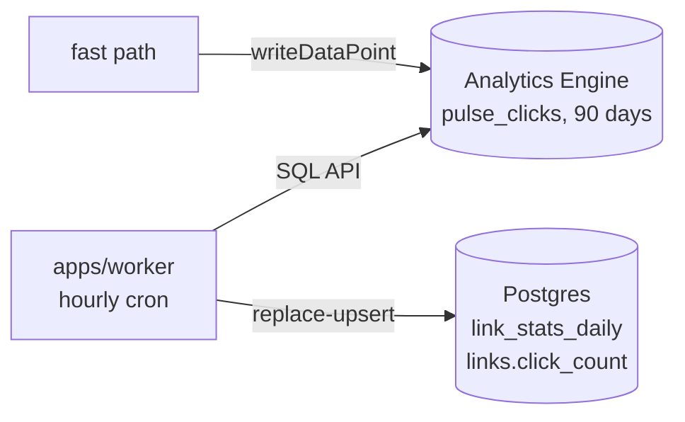

# M2 — Redirect fast path + click pipeline

> Make redirects fast and cheap, and capture every click without slowing a redirect down. Clicks are written at the edge to **Workers Analytics Engine**, and a cron Worker rolls them up into Postgres for long-term history and click counts. Everything runs on free tiers. Charts and breakdowns are M3.

| Field        | Value                                                                                      |
| ------------ | ------------------------------------------------------------------------------------------ |
| Status       | **Draft**: decisions marked `PROPOSED` are open for review                                 |
| Parent doc   | [ARCHITECTURE.md](../ARCHITECTURE.md) (§4 overview, §7 hot path, §8 pipeline, §11 caching) |
| Depends on   | M1 (links, status pages, soft delete) ✅                                                   |
| Next         | M3 (analytics dashboard)                                                                   |
| Estimate     | 5–7 days                                                                                   |
| Last updated | 2026-10-15                                                                                 |

---

## 1. Goal

At the end of M2:

1. `/r/<code>` is served by a **fast path** that runs before the app ([ADR 0008](../adr/0008-redirect-fast-path-in-web-worker.md)), reads from **KV**, and only touches Postgres on a cache miss.
2. Every tracked redirect writes one data point to **Analytics Engine** (non-blocking).
3. A separate **cron Worker** (`apps/worker`) rolls clicks up hourly into Postgres (`link_stats_daily`, `links.click_count`).
4. Link cards show a **click count** (at most ~1 h behind) and "last clicked".
5. QR scans are **attributed** separately from link clicks.
6. A k6 run gives **measured** p95 and cold-start numbers, published in the README.

---

## 2. Current state (start of M2)

- `pulse-web` (TanStack Start on Workers, **Workers Free plan**) serves `pulse.devxsameer.me`. `/r/$shortCode` is a normal file route: Postgres lookup (Neon HTTP driver) → 302 or a static status page.
- DB access: `drizzle-orm/neon-http`, client created lazily once per isolate (`getDb()`).
- No KV, no analytics. `LinkCard` shows a hard-coded `0 clicks`.
- QR codes encode `<origin>/r/<code>`.
- CI deploys `pulse-web` from `main` after migrations.

---

## 3. Scope

| #   | Feature            | Summary                                                                                                  |
| --- | ------------------ | -------------------------------------------------------------------------------------------------------- |
| F1  | Hyperdrive         | Web and the cron Worker reach Neon through Hyperdrive with `postgres.js`; request-scoped DB client       |
| F2  | Redirect fast path | Custom Worker entry; import-restricted `src/edge/`; app lazy-loaded; `/r/$shortCode` route removed       |
| F3  | Link cache         | KV read-through with invalidate-on-write; negative cache in the Cache API; per-IP redirect rate limit    |
| F4  | Click capture      | Enrich at the edge (device, browser, OS, bot, referrer, visitor hash) → `writeDataPoint`; QR attribution |
| F5  | Rollup cron Worker | `apps/worker`: hourly, idempotent rollup of today + yesterday into Postgres                              |
| F6  | Click count        | `links.click_count` / `last_clicked_at` from the rollups; shown on link cards                            |
| F7  | Load test          | k6 against production within free-tier limits; numbers + ADR 0008 split criteria in the README           |

Not in M2: charts, breakdowns, link detail page, date ranges (M3); Queues and webhooks (post-v1, or when on Workers Paid); staging (M6); short domain (`/r/` stays); password links (post-v1).

---

## 4. Decisions

| ID  | Question               | Recommendation                                                                                                                                                                                       | Status   |
| --- | ---------------------- | ---------------------------------------------------------------------------------------------------------------------------------------------------------------------------------------------------- | -------- |
| D1  | Plan                   | **Workers Free + free tiers only.** Design within the limits in §5.                                                                                                                                  | ACCEPTED |
| D2  | Click store            | **Workers Analytics Engine** (dataset `pulse_clicks`): 100k writes and 10k queries per day free, no extra vendor. Supersedes ARCHITECTURE D3. Tinybird and Queues were rejected on free-tier limits. | PROPOSED |
| D3  | Long-term history      | WAE keeps 90 days. A **separate cron Worker** (`apps/worker`) rolls clicks up into Postgres (`link_stats_daily`), which is kept indefinitely.                                                        | ACCEPTED |
| D4  | DB connectivity        | **Hyperdrive + `postgres.js`** with **query caching disabled**, so the app never reads stale rows after a write. drizzle-kit keeps using the direct URL.                                             | ACCEPTED |
| D5  | Short links URL        | **Keep `pulse.devxsameer.me/r/<code>`.** A short domain later only adds a host check.                                                                                                                | ACCEPTED |
| D6  | Staging                | **Not in M2.** Local + production only; staging arrives in M6.                                                                                                                                       | ACCEPTED |
| D7  | KV consistency         | **Fill on miss, invalidate on write.** Positive entries TTL 24 h; every update/enable/disable/delete deletes the key. No write on create. Keeps KV writes far below 1,000/day.                       | PROPOSED |
| D8  | Negative caching       | **Cache API, 60 s, per data center**, not KV: scanners would otherwise burn the KV write quota.                                                                                                      | PROPOSED |
| D9  | What counts as a click | **Every human GET**, no dedupe window. Bots are written with `is_bot = 1` and reported as "previews". `HEAD` requests redirect but aren't recorded.                                                  | PROPOSED |
| D10 | Visitor identity       | `visitor_hash = sha256(ip + ua + daily_salt)`, `daily_salt = HMAC(VISITOR_SALT_SECRET, UTC date)`: no stored salt, no cron. The IP never leaves the edge. `DNT: 1` / `Sec-GPC: 1` → empty hash.      | PROPOSED |
| D11 | Sampling               | WAE may sample at high volume. Every query counts with **`SUM(_sample_interval)`**, never `COUNT(*)`.                                                                                                | PROPOSED |
| D12 | Rollup strategy        | **Hourly cron, replace-upsert** of today and yesterday (UTC) per `(link, day, dimensions)`. Re-running is always safe; late data is picked up the next hour. No watermark table needed.              | PROPOSED |
| D13 | QR attribution         | QR codes encode `/r/<code>?qr=1`; the fast path records `is_qr = 1`. The parameter is ours and isn't forwarded.                                                                                      | PROPOSED |
| D14 | Opt out of tracking    | Header `X-Pulse-No-Track: 1` skips recording (like Dub's `dub-no-track`). Used by k6 and uptime checks.                                                                                              | PROPOSED |
| D15 | Shared code            | **No package extraction in M2.** Enrichment helpers live in `apps/web` (edge only); the cron Worker only runs SQL. `packages/core` / `packages/db` wait until a second app needs them.               | PROPOSED |

---

## 5. Free-tier budget

| Service                 | Free limit (per day, resets 00:00 UTC) | M2 usage                                                | When exceeded                                        |
| ----------------------- | -------------------------------------- | ------------------------------------------------------- | ---------------------------------------------------- |
| Workers requests        | 100,000                                | 1 per redirect + app traffic                            | Requests fail: the main reason to upgrade            |
| Workers CPU             | 10 ms per invocation                   | Fast path incl. light regex enrichment ≪ 10 ms          | Invocation errors → keep enrichment minimal          |
| KV reads                | 100,000                                | 1 per redirect                                          | Read throws → fall back to Postgres                  |
| KV writes / deletes     | 1,000 / 1,000                          | Fills ≈ distinct links clicked per day; deletes = edits | Write fails → logged; next request reads Postgres    |
| Analytics Engine writes | 100,000                                | 1 per tracked redirect                                  | Data points dropped; redirects unaffected            |
| Analytics Engine reads  | 10,000                                 | ~2 per hourly rollup (~50/day); M3 dashboards, cached   | Rollup retries next hour                             |
| Hyperdrive queries      | 100,000                                | App queries + KV misses + a few per rollup              | Queries fail → app errors; KV redirects still served |
| Neon (monthly)          | 100 CU-hours, 1 GB storage             | KV keeps compute mostly idle; rollups are small         | Compute suspends → app down until next month         |

Upgrade trigger: sustained > 50k redirects/day or Neon CU-hours > 75% mid-month.

---

## 6. Redirect fast path

Implements [ADR 0008](../adr/0008-redirect-fast-path-in-web-worker.md).

**Entry.** `wrangler.jsonc` `main` → `apps/web/src/server.ts`:

```ts
export default {
  async fetch(request, env, ctx) {
    const match = matchShortLink(request); // GET/HEAD /r/<code> on the app host
    if (match) return handleRedirect(request, env, ctx, match.code);

    const { default: app } = await import("@tanstack/react-start/server-entry");
    return app.fetch(request, env, ctx);
  },
};
```

**Flow for `/r/<code>`:**

1. Validate the code (`^[A-Za-z0-9_-]{1,64}$`); invalid → 404 page, no lookups.
2. Rate limit per IP (`REDIRECT_RATE_LIMITER`, 100 / 10 s) → 429 page.
3. Negative cache hit (Cache API) → 404 page.
4. KV `get("link:" + lower(code))` → hit: use it. Miss → one SQL query via Hyperdrive:
   - found → `ctx.waitUntil(KV.put(key, value, { expirationTtl: 86400 }))`
   - not found or deleted → `ctx.waitUntil(cache.put(negativeKey, 404, 60 s))`
5. Disabled/expired → 410 page (`lib/status-pages.ts`).
6. Active → record the click if tracked (§8), then `302 Location: url`, `Cache-Control: private, no-store`.

KV, cache, and analytics errors are caught and logged; the redirect still works. Only a failed Postgres lookup on a KV miss returns a 503 page.

**Cached value:**

```ts
type CachedLink = {
  v: 1;
  id: string;
  workspaceId: string;
  url: string;
  isActive: boolean;
  expiresAt: number | null; // epoch ms
};
```

**Invalidation.** `links.service` deletes `link:<lower(code)>` after every successful update, enable/disable, and delete (awaited, 3 retries). If it still fails: log an error; worst-case staleness is the 24 h TTL, plus KV's ~60 s global propagation.

**Import rule.** ESLint `no-restricted-imports` on `src/edge/**` and `src/server.ts`: no `react`, `@tanstack/*` (except the lazy `server-entry` import), `better-auth`, `#/features/*/server/*`, `#/features/*/components/*`.

---

## 7. Hyperdrive

- One Hyperdrive config (`pulse-db`) on Neon's **direct** (non-pooler) URL, `caching: disabled` (D4).
- `getDb()` becomes **request-scoped**: a `postgres.js` client per request (`max: 5`, `fetch_types: false`), closed with `ctx.waitUntil(sql.end())`. Workers must not share TCP connections across requests.
- Better Auth keeps the Drizzle adapter; only the driver changes (`drizzle-orm/postgres-js`).
- Local dev: `CLOUDFLARE_HYPERDRIVE_LOCAL_CONNECTION_STRING_HYPERDRIVE` in `.env` (dev branch URL), never committed.
- Migrations: unchanged (`drizzle-kit` with the direct `DATABASE_URL`).

---

## 8. Click capture + rollups



**Not recorded:** `HEAD` requests, `X-Pulse-No-Track: 1` (D14), non-active links.

**Data point layout** (`env.CLICKS.writeDataPoint`; positions are a contract, versioned by `blob1`):

| Field     | Value                                                                   |
| --------- | ----------------------------------------------------------------------- |
| `indexes` | `[linkId]` (sampling key)                                               |
| `blob1`   | schema version `"1"`                                                    |
| `blob2`   | `workspaceId`                                                           |
| `blob3`   | `shortCode`                                                             |
| `blob4`   | `country` (`request.cf`)                                                |
| `blob5`   | `city`                                                                  |
| `blob6`   | `continent`                                                             |
| `blob7`   | `referrerDomain` (normalized: `t.co` → `twitter.com`; empty → `direct`) |
| `blob8`   | `device` (`desktop`, `mobile`, `tablet`, `bot`, `other`)                |
| `blob9`   | `browser`                                                               |
| `blob10`  | `os`                                                                    |
| `blob11`  | `visitorHash` (D10)                                                     |
| `blob12`  | `isBot` (`"0"` / `"1"`): known-bot regex + datacenter ASN               |
| `blob13`  | `isQr` (`"0"` / `"1"`)                                                  |
| `doubles` | `[asn]`                                                                 |

Enrichment helpers (`src/edge/enrich.ts`: UA, bot, referrer, visitor hash) are pure and unit-tested.

**Rollup (`apps/worker`, cron `15 * * * *`).** For each of today and yesterday (UTC):

1. Query WAE grouped by `index1, blob2, blob4, blob8, blob7, blob12, blob13` → `clicks = SUM(_sample_interval)`, `last = MAX(timestamp)`.
2. In one transaction via Hyperdrive: delete that day's rows from `link_stats_daily`, insert the new ones (replace = idempotent).
3. Refresh `links.click_count = SUM(clicks WHERE NOT is_bot)` and `last_clicked_at` for the links touched.

**Query safety.** The WAE SQL API has no bind parameters. Every value interpolated into a query (link IDs, workspace IDs, dates) is validated first (UUID / ISO date) and built by one helper, `buildClicksQuery()`.

---

## 9. Data model changes (Postgres)

One migration, `0004_link_stats`:

**`links`: add columns**

| column            | type        | notes                                         |
| ----------------- | ----------- | --------------------------------------------- |
| `click_count`     | bigint      | not null, default 0; non-bot clicks, all time |
| `last_clicked_at` | timestamptz | nullable                                      |

**`link_stats_daily`: new table**

| column            | type    | notes                        |
| ----------------- | ------- | ---------------------------- |
| `link_id`         | uuid FK | → `links.id`, cascade        |
| `workspace_id`    | text FK | → `organization.id`, cascade |
| `day`             | date    | UTC                          |
| `country`         | text    | `""` when unknown            |
| `device`          | text    |                              |
| `referrer_domain` | text    |                              |
| `is_bot`          | boolean |                              |
| `is_qr`           | boolean |                              |
| `clicks`          | integer |                              |

Primary key `(link_id, day, country, device, referrer_domain, is_bot, is_qr)`; index `(workspace_id, day)`. `LinkView` gains `clickCount` and `lastClickedAt`.

---

## 10. Configuration

**`pulse-web` (`apps/web/wrangler.jsonc`):**

| Binding                 | Type             | Notes                        |
| ----------------------- | ---------------- | ---------------------------- |
| `HYPERDRIVE`            | Hyperdrive       | `pulse-db`, caching disabled |
| `LINKS`                 | KV namespace     | link cache                   |
| `CLICKS`                | Analytics Engine | dataset `pulse_clicks`       |
| `REDIRECT_RATE_LIMITER` | Rate limit       | 100 / 10 s per IP            |
| `METADATA_RATE_LIMITER` | Rate limit       | existing (M1)                |
| `VISITOR_SALT_SECRET`   | Secret           | `wrangler secret put`        |

**`apps/worker` (`apps/worker/wrangler.jsonc`):** `HYPERDRIVE`; cron trigger `15 * * * *`; secrets `CF_ACCOUNT_ID` and `CF_ANALYTICS_TOKEN` (API token scoped to **Account Analytics: Read** only).

**CI deploy job:** `db:migrate` → deploy `apps/worker` → deploy `apps/web`.

---

## 11. Post-M2

| Item                                 | Why it can wait                                                  |
| ------------------------------------ | ---------------------------------------------------------------- |
| Charts, breakdowns, link detail page | M3: WAE for the last 90 days (cached), `link_stats_daily` beyond |
| Unique visitors per day              | M3, from WAE (see §15)                                           |
| Queues + webhooks on click           | When on Workers Paid; post-v1                                    |
| Short domain + host-based routing    | `/r/` works; adding a host check is small                        |
| Split fast path into its own Worker  | Only when ADR 0008 triggers fire                                 |

---

## 12. Security & privacy checklist

- [ ] Raw IPs never leave the edge; only `visitor_hash` (daily-salted) is written.
- [ ] DNT / GPC requests are counted with an empty `visitor_hash`.
- [ ] The analytics API token is read-only and lives only in `apps/worker` (and `pulse-web` in M3), never in the browser.
- [ ] Every WAE query is built by `buildClicksQuery()` from validated values; tenant filters always come from `requireWorkspace()`.
- [ ] Invalid short codes never touch KV or Postgres; the per-IP redirect rate limit is enforced.
- [ ] `src/edge/` import restriction is enforced by ESLint in CI.

---

## 13. Acceptance criteria

- [ ] A redirect served from KV makes **no** Postgres query (verified in Workers logs).
- [ ] Disabling, deleting, or editing a link changes its `/r/` behavior within ~60 s globally.
- [ ] A burst of requests to random codes doesn't increase KV writes.
- [ ] A click appears in WAE within a minute and on the link card after the next hourly rollup.
- [ ] Re-running the rollup for the same day leaves `link_stats_daily` and `click_count` unchanged.
- [ ] QR scans are recorded with `is_qr = 1`; `X-Pulse-No-Track` and `HEAD` requests aren't recorded.
- [ ] Social preview bots are recorded with `is_bot = 1` and don't increment `click_count`.
- [ ] k6 numbers (p50/p95, cold start, KV hit rate) are in the README, with the ADR 0008 split criteria.
- [ ] CI is green and deploys `apps/worker` before `apps/web`.

---

## 14. Task breakdown (PR-sized)

1. **Hyperdrive**: create `pulse-db` (caching off), switch `getDb()` to request-scoped `postgres.js`, local dev env var. No behavior change.
2. **Fast path refactor**: `src/server.ts`, `src/edge/` (match, handler, lookup), ESLint import rule, redirect rate limit, delete `/r/$shortCode`. Same behavior as M1.
3. **KV cache**: `LINKS` namespace, read-through + fill on miss, Cache API negative cache, invalidate in `links.service`.
4. **Click capture**: `CLICKS` dataset, `src/edge/enrich.ts`, visitor hash, no-track header, QR `?qr=1` (QR dialog + fast path).
5. **Rollup cron Worker**: `apps/worker` (Turborepo app, own `wrangler.jsonc`), `buildClicksQuery()`, replace-upsert; migration `0004_link_stats` (you generate it); CI deploy order.
6. **UI**: click count and "last clicked" on `LinkCard`.
7. **Load test**: k6 script in `tools/k6/`, short bursts within free limits, `X-Pulse-No-Track`; numbers in README.
8. **Docs**: ADRs for D2 (Analytics Engine, supersedes ARCH D3), D4 (Hyperdrive), D7–D8 (cache strategy), D12 (rollups); update ARCHITECTURE.md (§4, §5, §7, §8, §9, §11, §21, decision log, roadmap).

Each PR: green CI, migrations generated and reviewed, never `db:push`.

---

## 15. Open questions

- **Distinct counts in WAE SQL:** confirm whether `COUNT(DISTINCT blob11)` is supported for unique visitors. If not, compute visitors in the rollup (per day) instead of at query time.
- **Lazy app import:** confirm that `@cloudflare/vite-plugin` + TanStack Start keep the dynamic `server-entry` import as a separate chunk. If not, the fast path still runs first, but the bundle isn't smaller; measure in task 7.
- **WAE billing:** Analytics Engine isn't billed yet; re-check the free limits when Cloudflare turns billing on.
